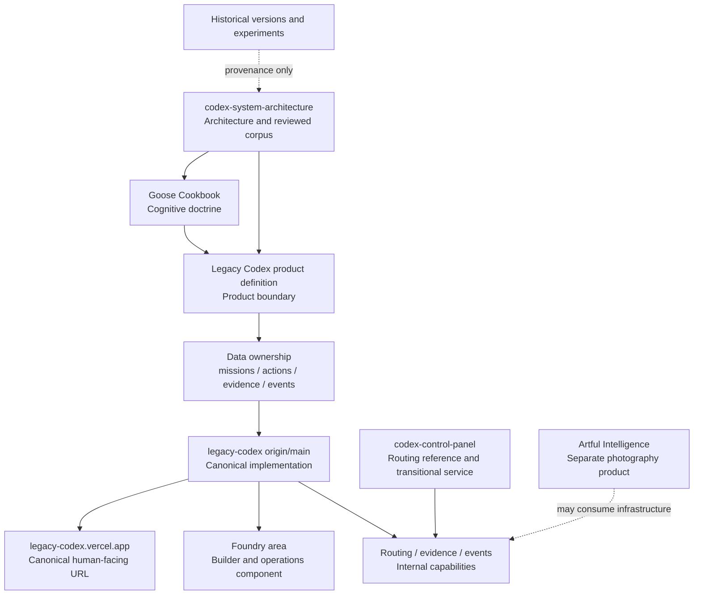

# Legacy Codex Canonical Source Graph

**Status:** Canonical navigation map
**Last source reconciliation:** 2026-11-04

Runtime observations are dated separately in PROJECT_STATUS.md.

This graph tells a fresh human or AI which source answers which question. A newer implementation does not silently supersede doctrine, and an old version label does not outrank current evidence.

## Authority by question

| Question | Canonical source | Does not establish |
| --- | --- | --- |
| What is the deep cognitive doctrine? | `codex-system-architecture/notion-wiki/docs/GOOSE-COOKBOOK.md` | Current deployment state |
| What is Legacy Codex and what is Foundry? | `docs/architecture/legacy-codex-product-definition.md` | A feature is implemented or live |
| Which store owns which truth? | `docs/architecture/data-ownership.md` | That every migration is applied in production |
| What code is current? | `edwardemoryphotography/legacy-codex` `origin/main` | That the commit is deployed |
| What is the canonical user URL? | `https://legacy-codex.vercel.app` | Runtime health without direct verification |
| What is currently merged, deployed, or blocked? | `PROJECT_STATUS.md`, rechecked against GitHub, Vercel, and runtime | Future state |

## Doctrine in the application

The reviewed runtime projection is src/lib/cognitiveDoctrine.ts, with a pinned Cookbook revision. Analysis, Brief, bounded operation assistance and Project Review use it with distinct route contracts. Codex → Root → North Star exposes its source. Runtime prompts do not own doctrine.

| Capability | Context and implementation | Persistence boundary |
| --- | --- | --- |
| Artifact analysis | /api/analyze; supplied files/directive and scoped confirmed lessons | Display-only answer; no arbitrary history crawl or automatic lesson save |
| Project reconstruction | /api/delta-review; caller-scoped missions, actions, notes, corrections, evidence projections, bounded related-project records, explicitly linked public GitHub text | Explicit draft/critique; cache/history in transitional mission_events |
| Confirmed lessons | /api/delta-lessons; conditions, scope, provenance, human confirmation and retirement | Append-only Mission guidance; not canonical evidence |
| Later retrieval | learnedContext.ts and project-review context assembly | Caller JWT/RLS; bounded reads, explicit missing context |
| Legacy Relay | /api/lesson-relay; recipient explicitly adopts shared rule/conditions | No private source records or widened model access; real recipient benefit needs separate acceptance |
| Conversation / voice | Home/Mission; /api/brief and /api/live-voice | Existing context/routes; commitments require explicit save |
| Territory | Real missions and owner-scoped territory_nodes, Map/List | Stored relationships only; no invented edges |
| Action continuity | Shared NextAction projection and atomic replacement | actions owns commitments; proposal acceptance differs from saving |

A read, model proposal, confirmed lesson, saved commitment and verified outcome are different states. The analyzer and Project Review have different retrieval scope; diagnose missing context against the actual route.

[November acceptance](../verification/november-acceptance-2026-11-04.md) records the real owner, later lesson and recipient sequence. [Accountability contract](../verification/model-accountability-transparency-2026-11-02.md) owns requirements; consult current PR/release state for #160's guard and #163's broader specification. Requirements alone are not enforcement.

## Surface classification

| Surface | Classification | Current decision |
| --- | --- | --- |
| Root Legacy Codex app | **CANONICAL** | Human-facing product and default entry point |
| Foundry Console source under this repo | **INTERNAL COMPONENT** | Builder/operator boundary; do not expose its machinery by default |
| Routing, evidence, events, control plane | **INTERNAL COMPONENT** | Capabilities owned by the canonical system |
| `codex-control-panel` | **MIGRATE INTO CANONICAL** | Human-facing next-move routing is now in Mission; guarded persistence remains a transitional Foundry service until its server boundary is moved |
| `codex-system-architecture` | **ARCHITECTURE / GOVERNANCE** | Reviewed corpus and system explanation, not the runtime product |
| PocketForge | **SEPARATE SUPPORTING MODULE** | Native app-building surface; it may hand work to Foundry but does not define the Legacy Codex front door |
| `artful-intelligence-hub` | **SEPARATE SUPPORTING SURFACE** | Flock operations, not a Legacy Codex front door |
| Artful Intelligence | **SEPARATE — ON PURPOSE** | Photography product with its own user and primary job |
| Historical version dashboards and prototypes | **EXPERIMENT / HISTORICAL** | Provenance only; they do not define current product state |

## Supersession rules

1. The product is called **Legacy Codex**. UI labels such as v24, v27, v35.3, and v38 are historical strata.
2. `legacy-codex.vercel.app` is the only URL presented as the normal product entry point.
3. The deleted in-app Consolidation checklist is superseded by this source graph and `PROJECT_STATUS.md`; repository cleanup is not a user workflow.
4. A code merge may update implementation truth but cannot claim `Deployed`, `Runtime Verified`, or `Live` without those separate checks.
5. When sources conflict, record the contradiction and resolve it in the source that owns that question. Do not create a new cross-cutting master document.

## Discoverable supersession

The August plan called #58 pending after a later August record documented completion. By November this graph and PROJECT_STATUS also described older implementation. The shared failure is preserved records without discoverable current truth.

When a release changes a capability or acceptance result, update its owning section here or in PROJECT_STATUS and link the dated evidence. Preserve previous observations as historical records. Record source-review and runtime-observation dates separately; do not leave incompatible baselines in a current-state table.
